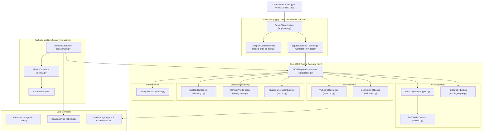

# EXAM PAPER EXTRACTOR — TARGET SYSTEM ARCHITECTURE

## 1. Architectural Vision & Principles

The goal of this restructuring is to transform an experimental OCR prototype into a **clean, maintainable, reproducible ML application**.

The design is governed by five core principles:
1. **Separation of Concerns**: Machine learning models, computer vision cropping, text post-processing, evaluation benchmarks, and web APIs reside in dedicated, decoupled packages.
2. **Frozen API Contract**: The FastAPI backend remains an external consumer of the OCR pipeline. Request/response schemas, routes, and behavior are 100% preserved.
3. **Reproducibility**: The 146-page benchmark can be run on-demand with a single command, producing versioned machine-readable and human-readable reports.
4. **Observable Fallbacks**: Fallbacks (such as geometric layout fallbacks for missing YOLO detections) are explicit, traceable, and diagnostic.
5. **Defensive Processing**: The core pipeline rejects corrupted inputs and clips bounding boxes defensively, distinguishing fatal system errors from normal OCR uncertainty.

---

## 2. High-Level Architecture Diagram



---

## 3. Package & Module Responsibilities

### 1. `app/` (FastAPI Application Layer)
* **`app/main.py`**: Web application instance, CORS, error handling (400, 413, 422, 500), `/health`, `/predict`.
* **`app/schemas.py`**: Immutable request/response contracts (`HealthResponse`, `ExtractionResult`, `PredictResponse`, etc.).
* **`app/config.py`**: Centralized application settings powered by `pydantic-settings`.
* **`app/services/ocr_service.py`**: Backward-compatible singleton adapter exposing `process_image()` and `initialize()`, internally delegating to `ocr.pipeline:OCREngine`.

### 2. `ocr/` (Core Reusable OCR Engine)
* **`ocr/pipeline.py`**: Single entry point `OCREngine` coordinating the complete pipeline lifecycle.
* **`ocr/detection/detector.py`**: YOLOv8 wrapper; validates confidence, clips bounding boxes within $[0, W]$ and $[0, H]$, discards degenerate boxes.
* **`ocr/detection/fallbacks.py`**: Deterministic layout geometry fallbacks for `enrolment_no` and `grand_total` when YOLO detections are absent.
* **`ocr/recognition/paddle_engine.py`**: PaddleOCR wrapper with Windows CPU flags and torch import isolation hook.
* **`ocr/recognition/divider.py`**: Red divider line locator separating printed label from handwritten marks.
* **`ocr/recognition/cropper.py`**: Handles primary field cropping, red-divider tightened crop, and companion words crop.
* **`ocr/postprocessing/cleaning.py`**: Strategy B text normalization:
  - Institutional prefix anchor `0801CA25` + serial digit correction
  - Subject code normalization (`CT10718`)
  - Mathematical rounding & equation recovery ($X.5 = X + 1$).
* **`ocr/postprocessing/word_parser.py`**: English number words parser (e.g. `'FIFTY FOUR'` $\rightarrow 54$).
* **`ocr/postprocessing/fusion.py`**: Dual-source score fusion reconciling numeric candidate with words candidate.
* **`ocr/validation/sanity.py`**: Lightweight sanity validator detecting format anomalies and assigning `needs_review = True` without altering values.

### 3. `evaluation/` (Benchmarking & Quality Control)
* **`evaluation/benchmark.py`**: Reusable 146-page benchmark command (`python -m evaluation.benchmark`).
* **`evaluation/metrics.py`**: Computes page-level exact match, field-level accuracies, transition breakdowns, and confusion counts.
* **`evaluation/reports/`**: Output directory for versioned markdown and CSV reports.

### 4. `scripts/` (Operational Utilities)
* **`scripts/run_ocr.py`**: Standalone CLI runner.
* **`scripts/train_detector.py`**: YOLO fine-tuning tool.
* **`scripts/prepare_dataset.py`**: Train/val dataset splitter.
* **`scripts/convert_xml_to_yolo.py`**: Annotation converter.
* **`scripts/label_cover_sheet.py`**: Interactive CLI labeling tool for annotating new exam sheets.

### 5. `models/` & `data/`
* **`models/registry.json`**: Model registry tracking active versions, paths, training dataset versions, and mAP metrics.
* **`data/canonical_labels.csv`**: Single standard ground-truth reference file.
* **`data/raw/`**: Source images and labels.

---

## 4. End-to-End Data Pipeline & Contracts

```text
Input: Image File Path | In-Memory cv2 Image
  │
  ▼
OCREngine.process(img)
  │
  ├─ 1. Defensive Validation: BGR conversion, min 200x200 px
  ├─ 2. YOLO Detection: Bboxes for enrolment_no, subject_code, grand_total
  ├─ 3. Fallback Check: If enrolment missing -> geometric layout crop
  ├─ 4. Companion Cropping: Red divider cut -> tightened GT & marks_in_words
  ├─ 5. OCR Recognition: Run PaddleOCR on each crop
  ├─ 6. Normalization: Strategy B cleaning & word parsing
  ├─ 7. Score Fusion: Reconcile numeric total vs words total
  ├─ 8. Sanity Check: Validate formats & assign needs_review flag
  │
  ▼
ExtractionResult (Identical to existing backend schema)
{
    "rollno": "0801CA251001",
    "enrollment_no": "0801CA251001",
    "subject_code": "CT10718",
    "total_marks": 54,
    "total_marks_corrected": 54,
    "needs_review": false,
    "fusion_status": "AGREE_EXACT",
    "raw_ocr": { ... }
}
```
